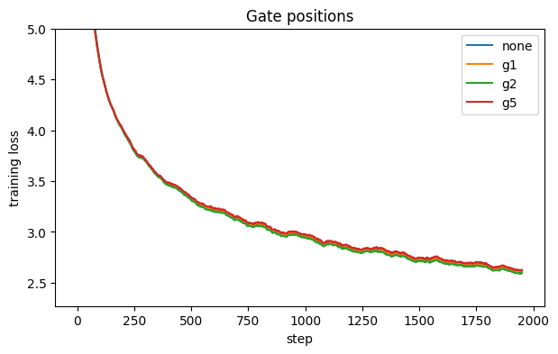
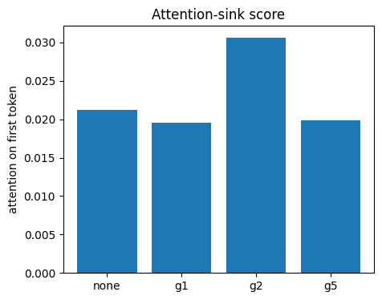
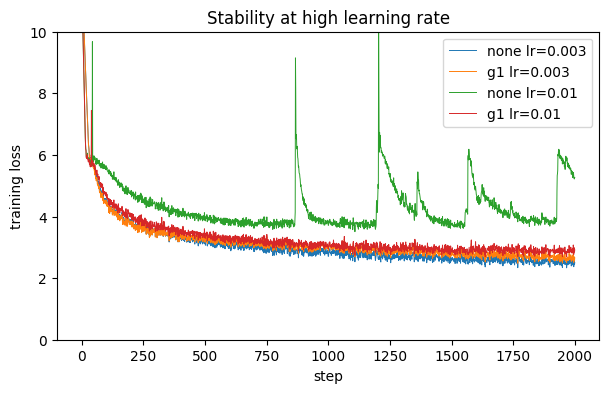

# gated-attention-for-llm# Gated Attention in a Small GPT (DL-058)

Reduced-scale reproduction of **Qiu et al., "Gated Attention for Large Language Models: Non-linearity, Sparsity, and Attention-Sink-Free"**, NeurIPS 2025 ([arXiv:2505.06708](https://arxiv.org/abs/2505.06708)).

**Task:** add head-specific sigmoid gating after scaled-dot-product attention (SDPA) in a small GPT, compare gate positions, and measure perplexity, training stability at high learning rate, and the first-token attention-sink score.

## Method

Standard attention, then the gate (G1, the paper's main method):

```
A  = softmax(Q Kᵀ / √d + M) V        # scaled dot-product attention, causal mask M
A' = A ⊙ σ(X W_g)                     # sigmoid gate from the current token's hidden state X
O  = A' W_O                           # output projection
```

Gate positions compared (the ablation):

| Variant | Gate position |
|---|---|
| `none` | no gate (baseline) |
| `g1` | after SDPA, before `W_O` (paper's main method) |
| `g2` | after the value projection `V` |
| `g5` | after the output projection `W_O` |

The gate is head-specific and elementwise: each head's slice of the output is scaled by its own gate values.

## Setup

| | Paper | This project |
|---|---|---|
| Model | 1.7B dense / 15B MoE | 29M GPT (4 layers, 4 heads, d_model = 256) |
| Data | Up to 3.5T tokens | TinyStories subset (100k stories, ~8.2M tokens seen per run) |
| Context length | 4,096 tokens | 128 tokens |
| Variants | 30 gating variants | 4 (none, G1, G2, G5) |
| Training | AdamW, warm-up + cosine decay | 2,000 steps, batch 32, AdamW, linear warm-up 100 steps |
| Hardware | GPU cluster | 1 × Colab T4 |

- **Dataset:** [TinyStories](https://huggingface.co/datasets/roneneldan/TinyStories) (Eldan & Li, 2023), GPT-2 tokenizer (`tiktoken`). Training uses the first 100,000 stories of the train split; evaluation uses the first 5,000 stories of the validation split.
- **Seed:** `torch.manual_seed(0)` for weights and a separate generator seeded with 0 for batches, so every variant sees identical data in identical order. Validation batches use seed 123.

## How to run

1. Open `gated_attention_simple.ipynb` in [Google Colab](https://colab.research.google.com/).
2. Runtime → Change runtime type → **T4 GPU**.
3. Runtime → **Run all**. Total time is about 40–60 minutes.

Dependencies (`torch`, `tiktoken`, `datasets`, `matplotlib`, `numpy`) are installed in the first cell. TinyStories downloads automatically.

Outputs: `results.json`, `plot_gate_positions.png`, `plot_sink.png`, `plot_stability.png`.

## Metrics

- **Perplexity** = exp(mean validation cross-entropy loss). Lower is better.
- **Sink score (F-Attn)** = mean attention weight that query positions 1…T−1 give to position 0, averaged over heads, layers and batches. Computed from the softmax attention weights, not the gated output.
- **Gate mean** = average sigmoid gate value (lower = sparser).
- **Loss spikes** = training steps (after warm-up) where the loss exceeds 1.2 × the mean of the previous 50 steps. **Diverged** = loss became NaN/inf.

## Results

### Experiment 1: gate positions (lr = 1e-3)

| Gate | Val. perplexity ↓ | Sink score ↓ | Gate mean | Loss spikes |
|---|---|---|---|---|
| none | 14.34 | 0.021 | – | 0 |
| g1 | 14.20 | 0.020 | 0.400 | 0 |
| g2 | **14.04** | 0.031 | 0.394 | 0 |
| g5 | 14.52 | 0.020 | 0.457 | 0 |

For reference, perfectly uniform causal attention over 128 tokens gives a sink score of 0.035, so none of these models formed a first-token sink.

### Experiment 2: stability at high learning rate

| Run | Diverged | Loss spikes | Val. perplexity |
|---|---|---|---|
| none, lr = 3e-3 | No | 0 | 12.90 |
| g1, lr = 3e-3 | No | 0 | 14.86 |
| none, lr = 1e-2 | No (but did not recover) | 84 | 185.50 |
| g1, lr = 1e-2 | No | **0** | **18.89** |





### Comparison with the paper

| Result | Paper | This project | Reproduced? |
|---|---|---|---|
| Perplexity, none → G1 | 6.026 → 5.761 (−4.4%) | 14.34 → 14.20 (−1.0%) | Yes, smaller effect |
| High learning rate | Baseline diverges at 8e-3; gated model trains | 84 → 0 spike steps at 1e-2 | Yes |
| G5 vs. none | 6.017 (−0.1%) | 14.52 (+1.3%) | Yes (no benefit) |
| First-token attention, none → G1 | 0.467 → 0.048 | 0.021 → 0.020 | No (no sink formed) |
| G1 mean gate value | 0.116 | 0.400 | Weaker sparsity |

Paper numbers are from Tables 1, 2 and 4 of arXiv:2505.06708 (15B MoE models trained on 400B tokens for Tables 1 and 4; 1.7B dense models for Table 2).

## Files

| File | Contents |
|---|---|
| `gated_attention_simple.ipynb` | Model, training, evaluation and plots (runs end to end on Colab) |
| `results_output.txt` | Printed output of the run reported here |
| `plot_gate_positions.png`, `plot_sink.png`, `plot_stability.png` | Result plots |

## Limitations

- The model is roughly 60–500× smaller than the paper's and trained on far fewer tokens, so effect sizes are expected to be smaller.
- One seed per configuration.
- Training windows start at random positions in the text, so position 0 is the first token of the window rather than a dedicated start-of-sequence token.
- Gate positions G3 and G4 (after K and Q) were not tested.
- Learned absolute position embeddings and a 128-token context are used; the paper uses RoPE and 4,096 tokens.

## References

1. Z. Qiu et al., "Gated Attention for Large Language Models: Non-linearity, Sparsity, and Attention-Sink-Free," NeurIPS 2025. arXiv:2505.06708.
2. R. Eldan and Y. Li, "TinyStories: How Small Can Language Models Be and Still Speak Coherent English?" arXiv:2305.07759, 2023.
3. A. Vaswani et al., "Attention Is All You Need," NeurIPS 2017.

No official or third-party repository was used for the implementation.
